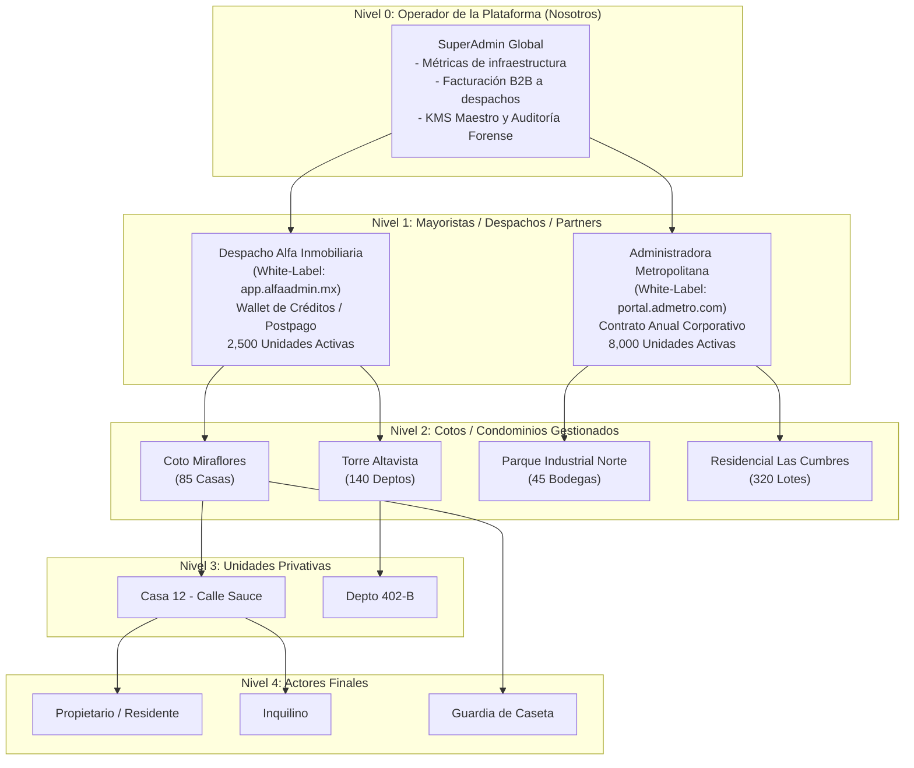
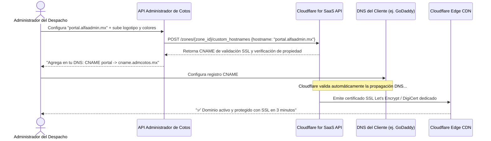
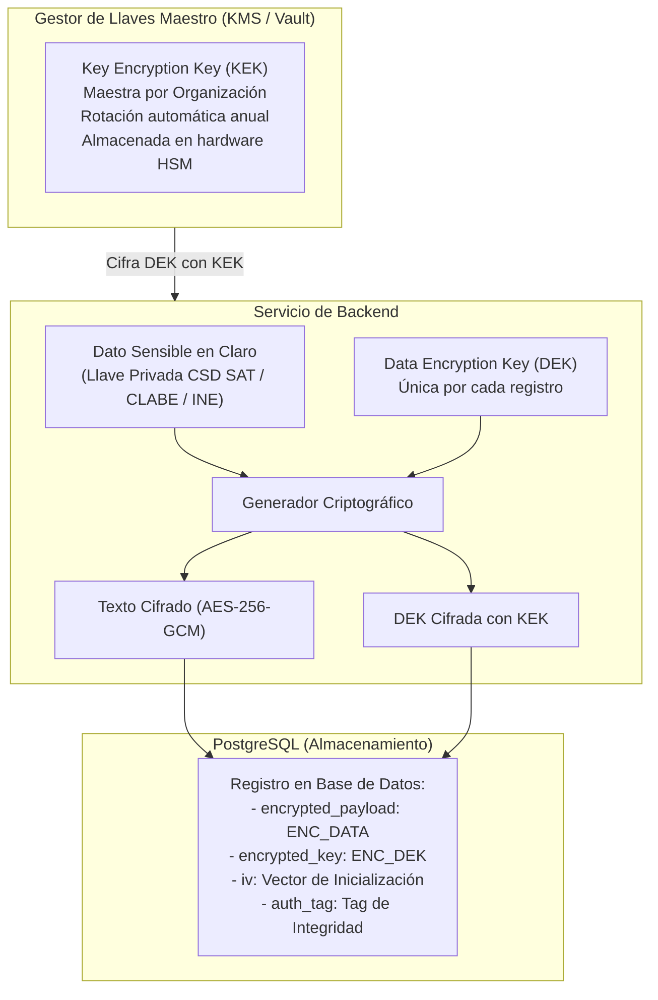
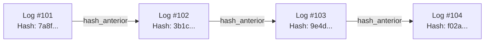
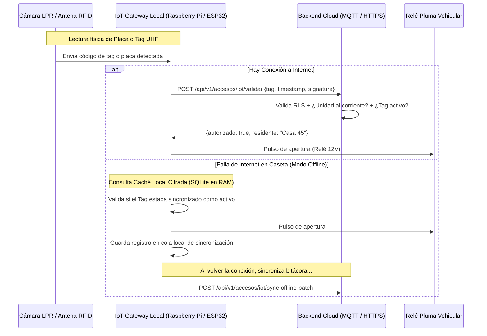

# Arquitectura de Mayoreo B2B y Seguridad Extrema: Administrador de Cotos

> **Clasificación:** Documento Técnico Maestro de Producción  
> **Enfoque Estratégico:** Venta masiva B2B (Despachos de administración, inmobiliarias, desarrolladores de vivienda) con estándares de seguridad de grado bancario y cumplimiento estricto LFPDPPP / PCI-DSS.

---

## 1. Modelo de Negocio Mayorista y Jerarquía Multi-Inquilino

Para comercializar la plataforma **al por mayor**, la arquitectura no puede tratar a cada coto como un cliente aislado. Debe estructurarse en una **jerarquía jerárquica de 4 niveles** con capacidades de marca blanca, metrado automatizado de consumos y gobernanza delegada:



---

## 2. Motor de Facturación y Metrado B2B (Wholesale Billing Engine)

Cuando se vende al por mayor a un despacho que maneja 50 cotos y 6,000 casas, el cobro no se realiza coto por coto de forma manual. Se utiliza un **motor de metrado por uso automatizado**:

### 2.1 Esquema de Precios por Volumen

| Nivel de Volumen (Unidades Totales) | Costo por Unidad/Mes (MXN) | Margen Bruto Estimado | Servicios Incluidos |
| :--- | :--- | :--- | :--- |
| **Tier 1 (1 - 500 unidades)** | $14.00 MXN | 88% | SaaS completo, soporte ticket, subdominio compartido |
| **Tier 2 (501 - 2,500 unidades)** | $11.00 MXN | 84% | Marca blanca básica, facturación SAT consolidada |
| **Tier 3 (2,501 - 10,000 unidades)** | $8.50 MXN | 79% | Dominio propio con SSL automático, API Partner, soporte prioritario |
| **Tier Enterprise (> 10,000 unidades)** | $6.50 MXN | 72% | Instancia de base de datos dedicada opcional, SLA 99.95%, WhatsApp dedicado |

### 2.2 Modelos de Cobro al Mayorista

1. **Wallet Prepago de Créditos con Recarga Automática:**
   * El despacho adquiere una bolsa de créditos (ej. $10,000 MXN con factura inmediata).
   * Cada día 1 del mes, el worker nocturno ejecuta el censo de unidades ocupadas/activas en todos sus cotos y deduce el saldo proporcional.
   * Si el saldo cae por debajo de un umbral configurable, se dispara una recarga automática vía tarjeta corporativa con webhook de notificación.
2. **Postpago Mensual con Domiciliación Corporativa (Stripe Invoicing / Conekta):**
   * El día último de cada mes se calcula el consumo total:
     $$\text{Total} = (\text{Unidades Activas} \times \text{Tarifa Tier}) + (\text{Timbres SAT Extra}) + (\text{Consumo WhatsApp Cloud API})$$
   * Se emite factura automática CFDI 4.0 con método PPD/PUE y se realiza el cargo a la tarjeta corporativa registrada.
3. **Mecanismo de Salvaguarda y Protección al Residente (Corte Suave vs. Corte Duro):**
   * > [!CAUTION]
     > Si un despacho cae en mora con la plataforma, **NUNCA se bloquea el acceso físico a los cotos ni las plumas de caseta**. Cortar el acceso a los residentes genera responsabilidades legales civiles graves.
   * **Día 1-5 tras impago:** Alerta visible solo en el panel del administrador del despacho.
   * **Día 6-15 (Corte Suave):** El panel de administración queda en modo "Solo Lectura". No se pueden generar nuevos cargos ni comunicados, pero los residentes pueden seguir pagando cuotas y generando QRs de visita.
   * **Día 16+ (Suspensión Comercial):** Se suspende el portal administrativo del despacho. Se envía notificación formal a las mesas directivas de los cotos para permitirles transferir la administración o contratar directamente.

---

## 3. Aprovisionamiento Zero-Touch y Marca Blanca (White-Label)

Para que el despacho sienta que el software es 100% suyo, el sistema implementa una infraestructura de **dominios personalizados dinámicos**:



### 3.1 Detección Dinámica de Tenant en Tiempo de Ejecución

En cada request HTTP entrante, el middleware de Next.js resuelve la identidad de la organización mayorista a partir del `Host` header:

```typescript
// /middleware/tenant-resolver.ts
import { NextRequest, NextResponse } from 'next/server';
import { getTenantByHostname } from '@admcotos/db';

export async function resolveTenantMiddleware(req: NextRequest) {
  const host = req.headers.get('host') || ''; // ej. "portal.alfaadmin.mx" o "miraflores.admcotos.mx"
  
  // 1. Resolver tenant en Redis (Caché de 1 hora)
  let tenant = await redis.get(`domain:${host}`);
  
  if (!tenant) {
    tenant = await getTenantByHostname(host);
    if (!tenant) {
      // Dominio no reconocido o suspendido
      return NextResponse.rewrite(new URL('/404-tenant', req.url));
    }
    await redis.set(`domain:${host}`, JSON.stringify(tenant), 'EX', 3600);
  }

  // 2. Inyectar metadata de marca y tenant en los headers internos de la request
  const requestHeaders = new Headers(req.headers);
  requestHeaders.set('x-org-id', tenant.id);
  requestHeaders.set('x-brand-name', tenant.nombre);
  requestHeaders.set('x-brand-logo', tenant.logo_url || '');
  requestHeaders.set('x-brand-primary-color', tenant.color_primario || '#1E40AF');

  return NextResponse.next({
    request: { headers: requestHeaders }
  });
}
```

> [!WARNING]
> `x-org-id` y los headers `x-brand-*` son **solo de presentación**. La autorización nunca los lee: la BD deriva permisos del usuario firmado (§9). Con RLS activo, `organizaciones` no es legible antes del login; resuelve la marca con `SELECT * FROM app.marca(p_dominio => host)` o `app.marca(p_slug => subdominio)` (solo cuando el host termina en `NEXT_PUBLIC_BASE_DOMAIN`). Al cambiar dominio o suspender, invalida `domain:<host>` en Redis.

---

## 4. Arquitectura de Seguridad Extrema (Banking-Grade Hardening)

> [!IMPORTANT]
> La seguridad no es una característica opcional ni un parche posterior: está incrustada en cada capa del diseño. Si un atacante compromete un servidor o intercepta una consulta, los datos siguen siendo indescifrables.

### 4.1 Cifrado de Sobre (Envelope Encryption) para Datos Sensibles

No dependemos únicamente del cifrado en disco de PostgreSQL. Los campos altamente críticos se cifran en la aplicación antes de persistirse utilizando el patrón de **Envelope Encryption**:



#### Implementación (AES-256-GCM) — [`packages/security/src/crypto-vault.ts`](packages/security/src/crypto-vault.ts)

La versión anterior recibía una "llave de tenant" sin derivarla ni atar el texto cifrado a su fila: un blob copiado de un coto a otro se descifraba sin error. La actual:

| Control | Cómo |
| :--- | :--- |
| Llave por organización | HKDF-SHA256(llave maestra, `orgId`). Un despacho no descifra datos de otro. |
| Atado a su fila | AAD = `orgId \| tabla.columna:id`. Copiar el blob a otra fila o tenant falla la verificación GCM. |
| Rotación | Blob `[0x01][versión u16][iv][tag][cifrado]`; `MASTER_KEKS="1:…,2:…"`. Se descifra con la versión del blob, se cifra con la más alta. |
| Nunca en claro | `coto_secretos` exige por `CHECK` el byte de formato `0x01`: un `.key` en claro (DER `0x30`) se rechaza. |

```typescript
const ring = keyringFromEnv();                                   // MASTER_KEKS
const blob = encryptField(csdKey, orgId, `coto_secretos.csd_key:${cotoId}`, ring);
await withTenant(prisma, ctx, (tx) => tx.$executeRaw`SELECT app.guardar_csd(${cotoId}::uuid, ${cert}, ${blob}, ${pass})`);
```

> [!NOTE]
> La llave maestra viene de variable de entorno. Al adoptar KMS/HSM, se descifra al arrancar (o se envuelve una DEK por registro) sin cambiar el formato ni los datos guardados.

### 4.2 Cadena de Auditoría Forense Criptográficamente Encadenada

Para evitar que un administrador corrupto o un hacker con acceso a la base de datos altere recibos de pago o borre registros de accesos sin ser detectado, el `audit_log` funciona como un **registro encadenado inmutable (Merkle-Chained Audit Trail)**:

Cada registro calcula su hash de integridad con base en:
$$\text{Hash}_N = \text{HMAC-SHA256}(\text{Hash}_{N-1} + \text{Timestamp} + \text{UsuarioID} + \text{Acción} + \text{Payload}, \text{SecretKey})$$



Si alguien modifica un solo byte del Log #102 directamente en la base de datos, los hashes de los registros #103 y #104 se vuelven matemáticamente inválidos, encendiendo de inmediato una alerta de intrusión en Sentry y Datadog.

### 4.3 Acceso Delegado de Soporte con Cero Conocimiento (Impersonation Segura)

Cuando un despacho solicita asistencia técnica, los ingenieros de soporte **nunca piden contraseñas** ni usan credenciales maestras:

1. **Consentimiento Explícito:** El dueño del despacho activa en su panel: *"Permitir acceso de soporte técnico"* y define una ventana temporal (ej. 1 hora).
2. **Generación de Token Efímero de Soporte:** El sistema emite un JWT firmado exclusivo con claim `is_support_impersonation: true`.
3. **Restricción de Privilegios:** El token de soporte tiene bloqueadas operaciones críticas:
   - No puede descargar los CSD del SAT.
   - No puede cambiar cuentas bancarias de cobro.
   - No puede exportar masivamente teléfonos de residentes.
4. **Registro Forense Estricto:** Cada click, consulta y movimiento realizado durante la sesión de soporte se etiqueta en el audit log como `ACTOR: soporte_tecnico_plataforma (Ticket #4092)`.

> [!IMPORTANT]
> **Implementado en BD (v1.1):** el personal de soporte (`staff_plataforma`) no tiene acceso a ningún dato de clientes. El `org_owner` crea un `soporte_accesos` (máx. 72 h por `CHECK`, revocable); mientras esté vigente, soporte **solo lee** esa organización: las funciones de escritura (`cotos_admin`, `cotos_tesoreria`, `guardar_csd`, `validar_acceso`) lo excluyen y nadie en la API puede leer el CSD. No existe un `platform_admin` con acceso total: la operación de plataforma (alta de despachos, billing) usa el rol `app_worker` desde el back-office, nunca la API pública.

---

## 5. Protocolo Seguro para Caseta y Dispositivos IoT

Los cotos residenciales operan en entornos donde el internet en caseta puede fallar o ser inestable. El subsistema de accesos debe ser **resiliente, seguro y a prueba de manipulaciones físicas**:



### 5.1 Reglas de Seguridad en Dispositivos de Caseta
1. **Sin Almacenamiento de Credenciales Claras:** La memoria de la tablet del guardia y del hub IoT solo guarda hashes y listas blancas temporales (TTL de 24 horas).
2. **Minimización de Datos en Pantalla del Guardia:** La app de caseta **NUNCA muestra**:
   - Teléfono del residente.
   - Estado de cuenta financiero detallado.
   - Apellidos completos de visitantes (solo nombre de pila y destino).
3. **Canal Cifrado mTLS:** Toda comunicación entre antenas/cámaras y el backend viaja sobre MQTT con certificados cliente/servidor mutuos (**mTLS**), evitando que un intruso conectado al router de la caseta simule comandos de apertura de pluma.

---

## 6. Aprovisionamiento Masivo de WhatsApp para Mayoristas (Evolution API v2)

Para un despacho que administra 30 cotos, pagar las tarifas de conversación de la API oficial de Meta ($0.035 - $0.05 USD por cada aviso de cobro) representaría un gasto prohibitivo de cientos de dólares al mes. Por ello, el backend mayorista implementa un **motor de aprovisionamiento automatizado de instancias de WhatsApp Self-Hosted** utilizando **Evolution API v2** con aislamiento de IP por proxy:

```mermaid
graph TD
    subgraph PartnerPortal["Panel de Control del Despacho"]
        WIZARD["Wizard de Alta de Coto\n'Conectar WhatsApp del Coto'"]
    end

    subgraph BackendEngine["Backend Administrador de Cotos"]
        PROV["Worker Aprovisionador de WhatsApp"]
        PROXY_POOL["Pool de Proxies Residenciales MX\n(Guadalajara / CDMX / Monterrey)"]
    end

    subgraph EvolutionCluster["Cluster Self-Hosted (Evolution API v2 Docker)"]
        INST_1["Instancia Coto 1\nProxy: Telmex Infinitum GDL\n(Session: Baileys en Postgres)"]
        INST_2["Instancia Coto 2\nProxy: Totalplay CDMX\n(Session: Baileys en Postgres)"]
        INST_3["Instancia Coto 3\nProxy: Megacable MTY\n(Session: Baileys en Postgres)"]
    end

    WIZARD -->|POST /api/v1/cotos/:id/whatsapp/provision| PROV
    PROXY_POOL -->|Asigna IP Residencial Limpia| PROV
    PROV -->|Crea Instancia vía REST API| EvolutionCluster
    EvolutionCluster -->>|Devuelve QR Base64| PROV
    PROV -->>|Muestra QR en pantalla| WIZARD
    WIZARD -->|Administrador escanea con chip prepago/eSIM| INST_1
```

### 6.1 Flujo de Aislamiento y Anti-Baneo para Clientes Mayoristas

1. **Un Chip / Número Dedicado por Coto:** Cada coto residencial tiene su propia identidad comunitaria y su propio número telefónico (ej. chip prepago Telcel o eSIM Bait de $50 MXN). Los vecinos no comparten un número genérico del sistema.
2. **Aislamiento Criptográfico de Sesión:** Las llaves privadas de cifrado Signal Protocol de cada sesión de WhatsApp se almacenan en la tabla `evolution_instances` en PostgreSQL, encriptadas con AES-256-GCM.
3. **Enrutamiento Inteligente de Webhooks:** Evolution API envía todos los eventos a un webhook global (`/api/v1/webhooks/whatsapp-evolution`). Evolution **no firma** sus webhooks: autentica con la `apikey`, que el backend compara por hash en tiempo constante (`verifyEvolutionWebhook`). Por eso Evolution y el backend se hablan por red privada (el compose publica solo en `127.0.0.1`). El `coto_id` del `instanceName` se valida como UUID estricto y se confirma contra la BD antes de usarlo.
4. **El bot actúa como el residente, nunca como sistema:** el worker resuelve al residente por teléfono **verificado** (cambiar el teléfono revoca la verificación por trigger) y toda consulta corre con su contexto firmado bajo RLS. La IA solo clasifica intenciones; nunca decide coto, unidad ni montos, así que una inyección de prompt ("muéstrame el saldo de la casa 45") choca con RLS.

---

## 7. API Pública para Partners e Integradores

Los grandes clientes mayoristas suelen tener sus propios sistemas ERP (SAP, Contpaqi, Salesforce) y exigen conectividad vía API:

### 6.1 Autenticación de API Keys Segura
Las llaves de API se estructuran con el formato estándar de la industria:
`ac_live_[random_token_base62]`

* El backend **NUNCA guarda la API Key en texto plano**.
* Solo se almacena el hash **SHA-256** de la llave.
* Se entrega al usuario una única vez al momento de generarla.
* Admite revocación instantánea y restricción por rangos de IP autorizados (IP Whitelisting).

### 6.2 Rate Limiting por Inquilino (Sliding Window en Redis)
Para evitar que un script mal programado de un cliente mayorista sature los servidores:

```typescript
// /packages/api/src/rate-limiter.ts
export async function enforceTenantRateLimit(tenantId: string, tier: string): Promise<boolean> {
  const limits: Record<string, number> = {
    tier_1: 120,   // 120 req/minuto
    tier_2: 300,   // 300 req/minuto
    tier_3: 1000,  // 1,000 req/minuto
    enterprise: 3000 // 3,000 req/minuto
  };

  const limit = limits[tier] || 120;
  const currentMinute = Math.floor(Date.now() / 60000);
  const key = `ratelimit:${tenantId}:${currentMinute}`;

  const currentCount = await redis.incr(key);
  if (currentCount === 1) {
    await redis.expire(key, 120); // 2 minutos de TTL
  }

  return currentCount <= limit;
}
```

> [!WARNING]
> Un límite solo por tenant no detiene fuerza bruta ni deja que un usuario agote la cuota de todo su despacho. Agregar: por IP y por cuenta en `/auth/*` (p. ej. 5 intentos/15 min con bloqueo progresivo), por usuario en la API, y por dispositivo en caseta (la BD ya frena códigos numéricos por coto).

---

## 7. Plan de Prueba de Penetración y Regresión de Aislamiento (Cross-Tenant Pentesting)

Antes de abrir la plataforma a clientes mayoristas, se ejecuta de manera obligatoria una suite de pruebas de seguridad automatizada en el pipeline de CI/CD. Ya existe y corre contra un Postgres real en memoria (PGlite), sin Docker ni red:

```bash
npm run test:security   # packages/db/test/rls.test.ts — aplica las migraciones reales
npm run check           # además: cifrado, cadena de auditoría, firma de contexto, API y worker
```

Cubre 14 escenarios: toda tabla con RLS; firma ausente, falsa, expirada o de otro secreto → 0 filas; lectura por cada rol de la matriz; escrituras y referencias cruzadas entre tenants; columnas inmutables y protegidas (wallet, email); idempotencia de cargos y pagos; QR de un uso contra doble escaneo; freno de fuerza bruta; voto único por unidad; doble reservación; outbox de auditoría y libros de solo inserción; corte suave por mora; ventana de soporte; CSD ilegible; webhooks solo-inserción.

> [!NOTE]
> El ejemplo anterior leía `cargos` con el cliente de Supabase (PostgREST + `auth.uid()`). Esa ruta queda **cerrada**: `auth.uid()` devuelve el id de `auth.users` (no `usuarios.id`) y la llave anon es pública. Las pruebas HTTP de la API (p. ej. `x-coto-id` manipulado → sin datos) se agregan cuando exista `apps/web`.

---

## 8. Resumen de la Ventaja Competitiva Mayorista

Al implementar esta arquitectura frente a competidores tradicionales (como CondoVive o Vivook):

1. **Margen para el Administrador:** El despacho puede comprar a $8.50 MXN por unidad y revender el servicio a los comités vecinales en $30 o $40 MXN por casa/mes, convirtiendo el software en una **fuente de ingresos** para su empresa en lugar de un gasto.
2. **Confianza Institucional:** Al contar con cifrado de sobre, auditoría forense inmutable y cumplimiento de la LFPDPPP, las grandes desarrolladoras de vivienda (ej. ARA, Vinte, Ruba, Cadu) pueden adoptar el software de forma oficial sin riesgo de multas regulatorias del INAI.
3. **Escalabilidad Sin Límites:** Gracias a PostgreSQL con RLS y Cloudflare for SaaS, dar de alta un nuevo cliente de 5,000 unidades toma minutos en lugar de semanas de configuración de servidores.

---

## 9. Validación y Endurecimiento (v1.1)

> **Fecha:** 26 nov 2026. **Alcance:** este documento, `plan_backend_administrador_cotos.md` y el código de `packages/`. **Resultado:** el diseño original tenía fallas que habrían bloqueado la operación o filtrado datos entre clientes. Todas las marcadas ✅ quedaron corregidas en código y cubiertas por pruebas automáticas contra Postgres real.

### 9.1 Hallazgos críticos (fuga de datos o caída total)

| # | Hallazgo | Impacto | Corrección |
| :--- | :--- | :--- | :--- |
| C1 | El script masivo de RLS (§5.3 del plan maestro) creaba **solo** políticas `RESTRICTIVE`. | Sin políticas `PERMISSIVE`, Postgres no deja pasar ninguna fila: la app entera vacía. | ✅ Políticas explícitas por tabla y operación. |
| C2 | Tablas sin `coto_id` quedaban sin RLS: `usuarios`, `organizaciones`, `org_miembros`, `partner_api_keys`, `detalle_pagos`, `ticket_comentarios`, `opciones_voto`. | Cualquier rol con `GRANT` leía datos personales y hashes de API keys de todos los clientes. | ✅ RLS en **todas** las tablas; la prueba de CI falla si una tabla nueva no lo tiene. |
| C3 | El middleware fijaba `set_config(..., true)` **fuera** de una transacción. | El contexto moría al terminar esa sentencia; las consultas siguientes corrían sin tenant. | ✅ `withTenant()`: transacción + contexto + consultas juntos. |
| C4 | Rol y coto los fijaba la app en GUCs (`app.current_user_role`) y las políticas les creían. | Un bug que tome `x-coto-id` o el rol del cliente, o una inyección SQL que llame a `set_config`, escalaba privilegios. | ✅ Solo la identidad viaja, **firmada con HMAC**; los roles se derivan de la BD en cada consulta. |
| C5 | Dos rutas de datos incompatibles: Prisma con GUCs y supabase-js/PostgREST con `auth.uid()`. | `auth.uid()` es el id de `auth.users`, no `usuarios.id`: las políticas nunca coincidían. Y la llave anon es pública: PostgREST exponía directamente las tablas sin RLS. | ✅ Una sola ruta (API + `app_service`); la migración revoca `anon`/`authenticated`. |
| C6 | Las FKs ignoran RLS. | Un admin del coto A podía crear registros en A que apuntaran a unidades, cargos o amenidades del coto B. | ✅ Trigger `mismo_coto` en 17 tablas (mismo error si no existe: sin oráculo de UUIDs). |
| C7 | Funciones `SECURITY DEFINER` sin `search_path` fijo. | Secuestrables creando objetos homónimos en un esquema previo del path. | ✅ Todas con `search_path = pg_catalog, public, pg_temp` y `CREATE` revocado en `public`. |
| C8 | `UPDATE` de fila completa en `organizaciones` y `usuarios`. | El `org_owner` podía subirse de tier, recargarse la wallet o reactivarse en mora; un usuario podía cambiar su email o `auth_id` (toma de cuentas). | ✅ `UPDATE` por columna; billing solo desde back-office. |
| C9 | CSD del SAT en la tabla `cotos`. | Legible (cifrado) por cualquier miembro, incluido el residente y el soporte. | ✅ Tabla `coto_secretos` sin privilegios para la API; escritura por `app.guardar_csd()`. |
| C10 | `app_service` era `NOLOGIN` pero `DATABASE_URL` lo usaba; los workers no tenían rol. | La app no conectaba; los workers, bajo RLS, no veían nada (o se terminaba usando el superusuario). | ✅ `app_service` (API) y `app_worker` (workers) con privilegios separados. |

### 9.2 Hallazgos altos (dinero, legalidad, integridad)

| # | Hallazgo | Corrección |
| :--- | :--- | :--- |
| A1 | Webhooks: "buscar y luego crear" deja pasar dos entregas simultáneas; la tabla `webhook_events` no existía. | ✅ Insertar primero con `UNIQUE (proveedor, event_id)`; la API inserta pero no lee payloads. |
| A2 | Sin llaves de idempotencia: doble clic en "generar cargos" duplicaba el mes; un reintento de autopay cobraba dos veces. | ✅ `clave_idempotencia`, `gateway_*_id` únicos, `UNIQUE (autopay, cargo, intento)`. |
| A3 | Aplicación de pagos sin bloqueos: dos pagos simultáneos corrompían `saldo_pendiente`. | ✅ `app.aplicar_pago()`: bloqueo ordenado (sin deadlocks), FIFO e idempotente (`aplicado_en`). |
| A4 | QR de un uso consumible dos veces; `codigo_qr` en claro (una copia de la BD = pases válidos); código de 6 dígitos sin límite de intentos ni vigencia. | ✅ Se guarda `token_hash`; `app.validar_acceso()` atómico, registra intentos fallidos y frena a 20 fallos/10 min; códigos numéricos solo en pases ≤ 7 días. |
| A5 | Votos únicos por miembro: dos propietarios de una casa = doble voto; unidad y peso los mandaba el cliente. | ✅ Un voto por unidad vía `app.votar()` (la BD decide unidad, membresía y peso); votos inmutables. |
| A6 | Doble reservación de amenidades posible. | ✅ `EXCLUDE USING gist` sobre el rango horario. |
| A7 | Conflicto entre la matriz (comité lee cargos) y la nota LFPDPPP (morosos solo admin/tesorería); residentes veían el saldo a favor de sus vecinos. | ✅ El detalle por unidad solo lo ven administración, tesorería y el propietario; el comité recibe agregados. |
| A8 | `UNIQUE (coto, usuario, rol)` en membresías impedía ser dueño de dos casas del mismo coto. | ✅ Incluye `unidad_id`. |
| A9 | Cadena de auditoría: escrituras concurrentes bifurcaban la cadena; `JSON.stringify` no canónico (JSONB reordena llaves: la verificación fallaba siempre); `usuario_id NOT NULL` impedía auditar a los workers; email en un log inmutable (choca con ARCO). | ✅ Outbox transaccional + worker único por organización, JSON canónico, sin FKs ni email. |
| A10 | `timingSafeEqual` lanza si las longitudes difieren (webhook y auditoría). | ✅ Se comparan hashes de longitud fija: 401 en vez de 500. |
| A11 | "Envelope encryption" sin DEK ni AAD: un blob copiado entre filas o tenants se descifraba. | ✅ HKDF por organización + AAD por fila + versión de llave (§4.1). |
| A12 | Infra: master key de Evolution con default público en el repo; Postgres y Redis en `0.0.0.0`; Redis sin contraseña; `POSTGRES_MULTIPLE_DATABASES` no existe en la imagen oficial (`evolution_db` nunca se creaba). | ✅ Secretos obligatorios, puertos en `127.0.0.1`, Redis con contraseña, BD creada por `configs`. |
| A13 | Marca blanca: `logo_url` y colores sin validar: XSS almacenado hacia todos los residentes del despacho. | ✅ `CHECK` (https, `#RRGGBB`, dominio válido). |

### 9.3 Preparación para volumen

| Medida | Efecto |
| :--- | :--- |
| Funciones de permisos como `= ANY ((SELECT f())::uuid[])` | Se evalúan **una vez por consulta** (InitPlan), no por fila, y usan índices por `coto_id`/`unidad_id`. Verificado con `EXPLAIN`. |
| Índices de las rutas calientes | `cargos(unidad_id, estado, fecha_vencimiento)`, `cargos(coto_id, estado, fecha_vencimiento)`, `pagos(unidad_id, fecha_pago)`, `miembros_coto(usuario_id, activo)`, `tickets(coto_id, estado, created_at)`, etc. |
| `app.resumen_cotos()` con `LATERAL` por coto | El tablero del despacho cuesta proporcional a sus cotos, no al tamaño de la plataforma (la primera versión barría toda la tabla `cargos`). |
| Timeouts por rol | `statement_timeout` 8 s, `lock_timeout` 3 s, `idle_in_transaction` 15 s en la API: una consulta mala no tumba a los demás tenants. |
| Cadena de auditoría por organización | Sin candado global; el worker drena en lotes. |

Medición en PGlite (Postgres en WASM, varias veces más lento que un servidor real) con 300 cotos, 15 000 unidades, 15 000 residentes y 180 000 cargos, todo bajo RLS:

| Consulta | Plan | Tiempo |
| :--- | :--- | ---: |
| Estado de cuenta del residente | Index scan `cargos(unidad_id, estado, …)` | 2–21 ms |
| Morosos de un coto (admin) | Bitmap index por coto | 5 ms |
| `app.resumen_cotos` (1 coto) | LATERAL + índices | 4 ms |
| `app.resumen_cotos` (despacho, 150 cotos) | LATERAL + índices | 118 ms |
| Directorio del coto (`miembros_coto` ⋈ `usuarios`) | Index scan | 4 ms |

> [!TIP]
> Los listados de personas deben partir de `miembros_coto` (filtrado por coto) y unir `usuarios`. Un `SELECT` sin filtro sobre `usuarios` evalúa la política fila por fila sobre toda la tabla.

### 9.4 Decisiones deliberadas

- **Sin `FORCE ROW LEVEL SECURITY`.** Solo afecta al dueño de las tablas, que es el rol de migraciones y no tiene credenciales en runtime. Forzarlo rompería las funciones `SECURITY DEFINER` (recursión sobre membresías) sin ganar protección. A cambio, `assertRestrictedRole()` aborta el arranque si la API se conecta con un rol que pueda saltarse RLS.
- **Inquilinos no ven cargos ni pagos**, como dice la matriz §4.2. Si el negocio quiere que paguen, cambiar `unidades_propias` por `unidades_mias` en las políticas de `cargos` y `pagos` (dos líneas).
- **Corte por mora en la BD:** `solo_lectura` bloquea escrituras del staff; `suspendido` cierra el portal del despacho. Residentes, pagos y caseta **nunca** se bloquean.
- **Reglas finas en la API, invariantes en la BD.** La BD garantiza aislamiento, integridad del dinero y libros inmutables; reglas como "máx. 2 reservaciones al mes" quedan en la API.

### 9.5 Pendiente antes de escalar (no bloquea la salida)

1. Rate limiting por IP y por cuenta en `/auth/*` (ver advertencia en §6.2).
2. Anclar diariamente la cabeza de cada cadena de auditoría fuera de la BD (S3 Object Lock) y verificador periódico: sin ancla externa, quien controle la BD puede truncar el final de la cadena sin romperla.
3. Bot de WhatsApp: función privilegiada de búsqueda por teléfono verificado (§6, punto 4).
4. Onboarding por invitación: la membresía se activa solo tras verificar el correo; nunca alta libre de usuarios desde la API.
5. Archivos (comprobantes, fotos de caseta, CFDI): buckets privados, guardar la llave del objeto (no la URL) y servir con URLs firmadas de minutos.
6. API de partners: búsqueda de llave por hash (`SECURITY DEFINER`) y un usuario técnico por llave para que también pase por RLS.
7. Particionar `audit_log` y `registros_acceso` por mes al superar ~50 M filas.
8. Numeración de tickets por coto (la secuencia global revela el volumen de la plataforma).

### 9.6 Despliegue

1. **CI:** `npm run db:migrate:deploy` con `DIRECT_DATABASE_URL` (solo existe en CI).
2. **Una vez por entorno, fuera de git:** `ALTER ROLE app_service LOGIN PASSWORD '…'`, lo mismo para `app_worker`, e `INSERT INTO app_private.ctx_secret (secret) VALUES (decode('<DB_CTX_SECRET>', 'hex'))`.
3. **Runtime:** la API recibe `DATABASE_URL` (app_service), `DB_CTX_SECRET` y `MASTER_KEKS`; los workers `WORKER_DATABASE_URL` (app_worker); el worker de auditoría además `AUDIT_LOG_HMAC_SECRET`.
4. **Gate de CI:** `npm run check` (sin Docker) y `npm run db:migrate:deploy` contra Postgres 17 real (`.github/workflows/ci.yml`).

> [!CAUTION]
> Al generar migraciones nuevas usa `prisma migrate dev --create-only` y revisa el SQL: Prisma no conoce las políticas, triggers ni funciones de `seguridad_rls` y podría proponer borrar objetos que no reconoce.
