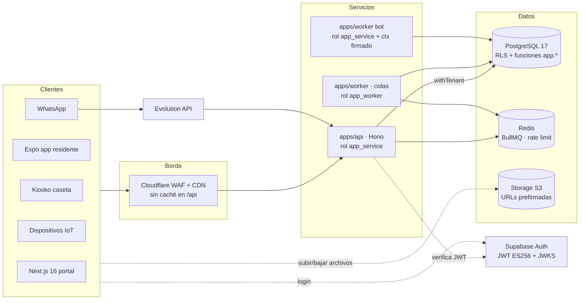

# Plan de Implementación por Fases — Backend

> **Para quién:** agentes de IA y desarrolladores que escriben el backend de Administrador de Cotos.
> **Cómo usarlo:** lee [`AGENTS.md`](AGENTS.md) (reglas siempre activas), luego §1–§3 de este documento y después **solo la fase en curso**. Cada tarea indica archivos, contratos, código de referencia, pruebas y criterio de terminado. No empieces una fase sin cerrar la anterior.
> **Versión:** 1.0 · 26 nov 2026 · versiones verificadas en npm ese día.

| Fase | Alcance | Estado |
| :--- | :--- | :--- |
| 0 | Fundaciones: monorepo, toolchain, BD con RLS, API y worker base, CI | ✅ Hecha |
| 1 | Identidad, MFA, tenancy y núcleo organizacional | ⏳ Siguiente |
| 2 | Finanzas: cargos, pagos manuales, egresos, reportes | — |
| 3 | Pagos en línea, domiciliación, CFDI y cobro a despachos | — |
| 4 | Comunicados, notificaciones, WhatsApp, IA, tickets y votaciones | — |
| 5 | Accesos, IoT, amenidades, marca blanca, API de partners y endurecimiento | — |

---

## 1. Arquitectura de referencia



**Por qué la API es un servicio propio (y no rutas de Next.js, como decía el plan maestro §10.2):** los secretos de BD y cifrado no viven en el servidor que renderiza HTML; web, móvil, caseta, bot e IoT consumen exactamente la misma API; un pool de conexiones estable soporta carga sin tormentas de conexiones serverless. La lógica de dominio no depende de Hono (servicios reciben `tx`), así que cambiar de framework es barato.

**Flujo de una petición autenticada**

1. `requestId` → log por petición → cabeceras de seguridad → CORS → límite de cuerpo (Fase 0).
2. `autenticacion` verifica el JWT con JWKS y resuelve `usuarioId` y `aal` (Fase 1).
3. `limiteTasa` por usuario e IP (Fase 1).
4. La ruta valida con Zod (422 si falla) y llama `conTenant(c, deps, cotoId, (tx) => servicio(tx, …))`.
5. `withTenant` abre transacción, firma `app.ctx` y ejecuta. **RLS decide qué filas existen para ese usuario.**
6. Errores → Problem Details. Cambios sensibles → `audit_outbox` (trigger) → worker → cadena HMAC.

### 1.1 Estructura del repositorio

```text
administradorcotos/
├── AGENTS.md · CLAUDE.md          # reglas para agentes (CLAUDE.md importa AGENTS.md)
├── plan_fases_backend.md          # este documento
├── plan_backend_*.md · DESIGN.md  # negocio, seguridad (§9) y diseño
├── package.json · turbo.json · tsconfig.base.json · biome.json · .npmrc · .node-version
├── Dockerfile · .dockerignore     # una imagen por servicio: --build-arg APP=api|worker
├── .github/workflows/ci.yml · .github/dependabot.yml
├── infra/docker-compose.whatsapp.yml   # Postgres, Redis y Evolution locales
├── apps/
│   ├── api/                       # ✅ Hono: HTTP, OpenAPI, webhooks
│   │   ├── src/main.ts            #    arranque, verificación de rol, apagado ordenado
│   │   ├── src/app.ts             #    createApp(deps): middleware + rutas
│   │   ├── src/env.ts · logger.ts · instrument.ts · types.ts
│   │   ├── src/middleware/        #    security.ts · errors.ts · logging.ts (+ auth.ts, rate-limit.ts en F1)
│   │   ├── src/routes/health.ts
│   │   ├── src/modules/<modulo>/  #    F1+: schemas.ts · routes.ts · service.ts
│   │   └── test/                  #    app.test.ts (+ <modulo>.test.ts, e2e/ en F1)
│   ├── worker/                    # ✅ BullMQ: auditoría (+ colas por fase)
│   │   └── src/main.ts · env.ts · processors/<cola>.ts
│   ├── web/ · mobile/ · caseta/   # frontends (fuera de este plan; ver README de cada carpeta)
├── packages/
│   ├── db/                        # ✅ Prisma 7, migraciones, withTenant, drainAuditOutbox, prueba RLS
│   ├── security/                  # ✅ cifrado por campo, cadena de auditoría, firma de contexto
│   ├── shared/                    # ✅ contratos Zod, AppError, Problem, SENTRY_SIN_PII
│   ├── whatsapp/                  # ✅ cliente Evolution, políticas anti-baneo
│   ├── storage/                   # F2: URLs prefirmadas S3
│   ├── notifications/             # F1 (correo) · F4 (push, WhatsApp)
│   ├── payments/                  # F3: Conekta + Stripe
│   ├── cfdi/                      # F3: timbrado
│   ├── ai/                        # F4: Gemini (intenciones, OCR)
│   └── iot/                       # F5: MQTT + mTLS
```

## 2. Stack y versiones

Fuente de verdad: [`AGENTS.md` §1](AGENTS.md#1-stack-verificado-el-26-nov-2026). Bibliotecas que entran en fases futuras (última estable al 26 nov 2026; **vuelve a verificar con `npm view` al iniciar la fase**):

| Fase | Paquete | Versión | Uso |
| :--- | :--- | :--- | :--- |
| 1 | `jose` | 6.2.18 | Verificar JWT con JWKS (ES256/RS256) |
| 1 | `rate-limiter-flexible` | 11.6.1 | Límite de tasa en Redis |
| 1 | `resend` | 6.40.1 | Correo transaccional |
| 1 | `@testcontainers/postgresql` | 12.2.2 | E2E local contra Postgres real (CI usa service container) |
| 2 | `@aws-sdk/client-s3` · `@aws-sdk/s3-presigned-post` · `@aws-sdk/s3-request-presigner` | 3.1178.0 | Storage S3-compatible (Supabase Storage S3, R2) |
| 2 | `csv-parse` | 7.0.3 | Importar unidades |
| 2 | `pdfkit` | 0.21.0 | Estados de cuenta en PDF |
| 3 | `conekta` | 9.0.11 | Cobros MXN: tarjeta, SPEI, OXXO |
| 3 | `stripe` | 23.2.0 | Cobro B2B a despachos |
| 3 | `xmlbuilder2` | 4.0.3 | Solo si el PAC exige XML sellado localmente |
| 4 | `@google/genai` | 3.6.1 | Intenciones del bot y OCR de comprobantes |
| 4 | `expo-server-sdk` · `web-push` | 8.0.0 · 4.0.0 | Push móvil y web |
| 4 | `libphonenumber-js` | 1.13.17 | Normalizar teléfonos (E.164) |
| 5 | `mqtt` | 5.16.1 | Puente IoT con mTLS |
| 5 | `qrcode` | 1.5.4 | Solo si el QR se genera en servidor (preferir cliente) |

---

## 3. Convenciones transversales (aplican a todas las fases)

### 3.1 Plantilla de módulo de la API

Cada módulo vive en `apps/api/src/modules/<modulo>/` y se monta en `app.ts` con `app.route('/api/v1', <modulo>Routes(deps))`. Ejemplo completo con **unidades** (Fase 1):

```ts
// apps/api/src/modules/unidades/schemas.ts — contratos públicos (van al OpenAPI)
import { z } from '@hono/zod-openapi';

export const TipoUnidad = z.enum(['casa', 'departamento', 'local', 'bodega', 'oficina', 'terreno']);

export const Unidad = z
  .object({
    id: z.uuid(),
    cotoId: z.uuid(),
    sectorId: z.uuid().nullable(),
    numero: z.string(),
    tipo: TipoUnidad,
    indiviso: z.string().nullable().openapi({ description: 'Fracción 0..1 como texto decimal' }),
    activo: z.boolean(),
  })
  .openapi('Unidad');

export const CrearUnidad = z
  .object({
    numero: z.string().trim().min(1).max(20),
    tipo: TipoUnidad.default('casa'),
    sectorId: z.uuid().optional(),
    indiviso: z.string().regex(/^(0(\.\d{1,6})?|1(\.0{1,6})?)$/).optional(),
  })
  .openapi('CrearUnidad');

export const CotoParam = z.object({
  cotoId: z.uuid().openapi({ param: { name: 'cotoId', in: 'path' } }),
});
```

```ts
// apps/api/src/modules/unidades/service.ts — dominio puro: recibe tx, no conoce HTTP
import type { Prisma } from '@admcotos/db';
import type { z } from '@hono/zod-openapi';
import type { CrearUnidad, Unidad } from './schemas.ts';

const columnas = { id: true, cotoId: true, sectorId: true, numero: true, tipo: true, indiviso: true, activo: true } as const;

function aDto(u: Prisma.UnidadGetPayload<{ select: typeof columnas }>): z.infer<typeof Unidad> {
  return { ...u, tipo: u.tipo as z.infer<typeof Unidad>['tipo'], indiviso: u.indiviso?.toString() ?? null };
}

export async function crear(tx: Prisma.TransactionClient, cotoId: string, datos: z.infer<typeof CrearUnidad>) {
  // RLS decide si el usuario puede crear en este coto; aquí no se repite esa regla.
  const u = await tx.unidad.create({ data: { cotoId, ...datos }, select: columnas });
  return aDto(u);
}

export async function listar(tx: Prisma.TransactionClient, cotoId: string, limite: number, cursor?: string) {
  const filas = await tx.unidad.findMany({
    where: { cotoId },
    orderBy: [{ numero: 'asc' }, { id: 'asc' }],
    take: limite + 1,
    ...(cursor ? { cursor: { id: cursor }, skip: 1 } : {}),
    select: columnas,
  });
  const siguiente = filas.length > limite ? filas.pop()?.id : undefined;
  return { datos: filas.map(aDto), siguiente };
}
```

```ts
// apps/api/src/modules/unidades/routes.ts — valida, documenta y delega
import { Paginacion } from '@admcotos/shared';
import { createRoute, OpenAPIHono, z } from '@hono/zod-openapi';
import { conTenant } from '../../lib/tenant.ts';
import { respuestasError } from '../../lib/openapi.ts';
import type { AppEnv, Deps } from '../../types.ts';
import { CotoParam, CrearUnidad, Unidad } from './schemas.ts';
import * as servicio from './service.ts';

const crear = createRoute({
  method: 'post',
  path: '/cotos/{cotoId}/unidades',
  tags: ['unidades'],
  summary: 'Crear una unidad',
  description: 'Permiso en BD: `cotos_admin` (administración del coto o despacho al corriente, con MFA).',
  security: [{ bearer: [] }],
  request: { params: CotoParam, body: { required: true, content: { 'application/json': { schema: CrearUnidad } } } },
  responses: {
    201: { description: 'Creada', content: { 'application/json': { schema: Unidad } } },
    ...respuestasError(401, 403, 409, 422),
  },
});

const listar = createRoute({
  method: 'get',
  path: '/cotos/{cotoId}/unidades',
  tags: ['unidades'],
  summary: 'Listar unidades (paginado por cursor)',
  security: [{ bearer: [] }],
  request: { params: CotoParam, query: Paginacion },
  responses: {
    200: {
      description: 'Página',
      content: { 'application/json': { schema: z.object({ datos: z.array(Unidad), siguiente: z.uuid().optional() }) } },
    },
    ...respuestasError(401, 403, 422),
  },
});

export function unidadesRoutes(deps: Deps) {
  return new OpenAPIHono<AppEnv>()
    .openapi(crear, async (c) => {
      const { cotoId } = c.req.valid('param');
      const unidad = await conTenant(c, deps, cotoId, (tx) => servicio.crear(tx, cotoId, c.req.valid('json')));
      return c.json(unidad, 201, { Location: `/api/v1/cotos/${cotoId}/unidades/${unidad.id}` });
    })
    .openapi(listar, async (c) => {
      const { cotoId } = c.req.valid('param');
      const { limite, cursor } = c.req.valid('query');
      return c.json(await conTenant(c, deps, cotoId, (tx) => servicio.listar(tx, cotoId, limite, cursor)), 200);
    });
}
```

```ts
// apps/api/src/lib/tenant.ts — atajo: el único camino de una ruta a la BD
import { withTenant, type Prisma } from '@admcotos/db';
import type { Context } from 'hono';
import type { AppEnv, Deps } from '../types.ts';

export function conTenant<T>(
  c: Context<AppEnv>,
  deps: Deps,
  cotoId: string | undefined,
  fn: (tx: Prisma.TransactionClient) => Promise<T>,
): Promise<T> {
  const { usuarioId, aal } = c.get('auth');
  return withTenant(deps.prisma, { userId: usuarioId, aal, cotoId, requestId: c.get('requestId') }, fn);
}
```

**Reglas de diseño HTTP**

| Tema | Regla |
| :--- | :--- |
| Prefijo y versión | `/api/v1`. Un cambio incompatible crea `/api/v2`; nunca se rompe v1 en sitio. |
| Recursos | Sustantivos en español y plural, anidados bajo el coto: `/cotos/{cotoId}/cargos`. |
| JSON | `camelCase`; fechas ISO 8601 (`2026-11-26` o con zona `Z`); dinero como texto decimal (`"1450.00"`). |
| Crear | `201` + `Location`. Acepta `Idempotency-Key` (ver §3.6). |
| Editar | `PATCH` parcial; solo campos editables en el esquema. |
| Borrar | No hay `DELETE` de negocio: `PATCH { activo: false }` o una acción (`POST …/cancelar`). |
| Acciones | `POST /recurso/{id}/<verbo>` (`/pagos/{id}/confirmar`). |
| Listas | Cursor (`?limite=25&cursor=<id>`), máximo 100, orden estable. Nunca `OFFSET` en tablas grandes. |
| Errores | Problem Details con `code` estable. 401 sin sesión · 403 sin permiso · 404 no existe **o no es visible** · 409 conflicto · 422 validación o regla. |
| Caché | `no-store` por defecto. Solo lo público (marca blanca) declara `Cache-Control: public, max-age=…`. |

`apps/api/src/lib/openapi.ts` exporta `respuestasError(...códigos)` que referencia un esquema `Problem` registrado una vez.

### 3.2 Autenticación (Fase 1, se usa en todas)

```ts
// apps/api/src/middleware/auth.ts
import { AppError } from '@admcotos/shared';
import type { MiddlewareHandler } from 'hono';
import { type JWTVerifyGetKey, jwtVerify } from 'jose';
import type { AppEnv } from '../types.ts';

export interface OpcionesAuth {
  jwks: JWTVerifyGetKey; // createRemoteJWKSet(new URL(`${SUPABASE_URL}/auth/v1/.well-known/jwks.json`)); en pruebas: createLocalJWKSet
  issuer: string; // `${SUPABASE_URL}/auth/v1`
  audience: string; // 'authenticated'
  resolverUsuario: (authId: string) => Promise<string | null>; // SELECT app.usuario_por_auth($1), con caché en memoria
}

export function autenticacion(o: OpcionesAuth): MiddlewareHandler<AppEnv> {
  return async (c, next) => {
    const header = c.req.header('Authorization');
    if (!header?.startsWith('Bearer ')) throw new AppError(401, 'no_autenticado', 'Inicia sesión para continuar');
    const { payload } = await jwtVerify(header.slice(7), o.jwks, {
      issuer: o.issuer,
      audience: o.audience,
      algorithms: ['ES256', 'RS256'], // nunca HS256 con secreto compartido
      clockTolerance: 5,
    }).catch(() => {
      throw new AppError(401, 'sesion_invalida', 'Tu sesión venció, vuelve a entrar');
    });
    if (!payload.sub) throw new AppError(401, 'sesion_invalida', 'Tu sesión venció, vuelve a entrar');
    const usuarioId = await o.resolverUsuario(payload.sub);
    if (!usuarioId) throw new AppError(403, 'sin_cuenta', 'Tu cuenta aún no está activa en ningún coto');
    c.set('auth', { usuarioId, authId: payload.sub, aal: payload.aal === 'aal2' ? 'aal2' : 'aal1' });
    await next();
  };
}
```

- `AppEnv.Variables.auth: { usuarioId: string; authId: string; aal: 'aal1' | 'aal2' }`.
- `resolverUsuario` usa un `Map` acotado (10 000 entradas, se vacía al llenarse): la relación `auth_id → usuario` no cambia.
- Rutas públicas (`/health/*`, `/webhooks/*`, `/marca`) se montan **antes** del middleware de autenticación.
- Antes de implementar, consulta `npx modern-web-guidance@latest search "passkey authentication"` para el flujo de MFA del staff.

### 3.3 Contexto de BD v2 con nivel de autenticación (Fase 1)

El staff debe tener MFA (plan maestro §4.1). Para que la **BD** lo exija, el contexto firmado incluye el `aal` del JWT:

```ts
// packages/security/src/tenant-context.ts — formato v2: "<uuid>.<aal1|aal2>.<exp>.<hmac>"
export function signDbContext(userId: string, secret: Buffer, opts: { aal?: 'aal1' | 'aal2'; ttlSeconds?: number } = {}) {
  const id = assertUuid(userId, 'userId');
  const aal = opts.aal ?? 'aal1';
  const exp = Math.floor(Date.now() / 1000) + (opts.ttlSeconds ?? 300);
  const payload = `${id}.${aal}.${exp}`;
  return `${payload}.${crypto.createHmac('sha256', secret).update(payload).digest('hex')}`;
}
```

```sql
-- En la migración de Fase 1 (CREATE OR REPLACE): app.uid() acepta solo v2 y se agrega app.aal()
-- regex: '^[0-9a-f]{8}-…-[0-9a-f]{12}\.aal[12]\.[0-9]{10}\.[0-9a-f]{64}$'
CREATE FUNCTION app.aal() RETURNS text LANGUAGE sql STABLE SECURITY DEFINER
SET search_path = pg_catalog, public, pg_temp AS $$
  SELECT CASE WHEN app.uid() IS NOT NULL THEN split_part(current_setting('app.ctx', true), '.', 2) END
$$;
-- app._cotos(..., p_escritura=true) agrega: AND (NOT o.exigir_mfa OR app.aal() = 'aal2')
```

`organizaciones.exigir_mfa boolean NOT NULL DEFAULT true`. Los residentes no necesitan MFA (sus permisos salen de `unidades_*`, no de `_cotos` de escritura).

### 3.4 Plantilla de migración para una tabla nueva

1. Edita `packages/db/prisma/schema.prisma` (índices con `@@index`, únicos con `@unique`).
2. `npm run db:migrate:dev -- --name <nombre>` (crea sin aplicar; requiere `DIRECT_DATABASE_URL` a un Postgres de desarrollo con permiso para crear la base *shadow*).
3. **Agrega al final del `migration.sql` generado:**

```sql
-- ── Seguridad de <tabla> ─────────────────────────────────────────────
ALTER TABLE <tabla> ENABLE ROW LEVEL SECURITY;
CREATE POLICY worker      ON <tabla> TO app_worker USING (true) WITH CHECK (true);
CREATE POLICY coto_activo ON <tabla> AS RESTRICTIVE TO app_service
  USING ((SELECT app.coto_activo()) IS NULL OR coto_id = (SELECT app.coto_activo()));
CREATE POLICY sel ON <tabla> FOR SELECT TO app_service USING (coto_id = ANY ((SELECT app.cotos_staff())::uuid[]));
CREATE POLICY ins ON <tabla> FOR INSERT TO app_service WITH CHECK (coto_id = ANY ((SELECT app.cotos_admin())::uuid[]));
CREATE POLICY upd ON <tabla> FOR UPDATE TO app_service USING (coto_id = ANY ((SELECT app.cotos_admin())::uuid[]));
GRANT SELECT, INSERT, UPDATE ON <tabla> TO app_service, app_worker;   -- sin DELETE

ALTER TABLE <tabla> ADD CONSTRAINT <tabla>_ck CHECK (estado IN ('...'));
CREATE TRIGGER mismo_coto BEFORE INSERT OR UPDATE OF coto_id, <fk> ON <tabla>
  FOR EACH ROW EXECUTE FUNCTION app.tg_mismo_coto('<fk>', '<tabla_padre>');
CREATE TRIGGER inmutable BEFORE UPDATE ON <tabla> FOR EACH ROW EXECUTE FUNCTION app.tg_inmutable('coto_id');
CREATE TRIGGER auditar AFTER INSERT OR UPDATE OR DELETE ON <tabla>
  FOR EACH ROW EXECUTE FUNCTION app.tg_auditar();                     -- si es dato sensible o financiero
```

4. Agrega escenarios a `packages/db/test/rls.test.ts`: quién ve, quién escribe, quién no, y referencia cruzada entre cotos.
5. `npm run check` y `npm run db:migrate:deploy` contra el Postgres de docker compose.

Conjuntos disponibles: `cotos_miembro`, `cotos_staff`, `cotos_finanzas`, `cotos_admin`, `cotos_tesoreria`, `cotos_guardia`, `unidades_mias`, `unidades_propias`, `orgs_lectura`, `orgs_admin`, `orgs_owner` (definición en la migración `seguridad_rls`).

### 3.5 Funciones SQL de negocio

```sql
CREATE FUNCTION app.<verbo>(p_... uuid) RETURNS ...
LANGUAGE plpgsql                                   -- INVOKER por defecto: respeta RLS
AS $$
BEGIN
  IF <regla rota> THEN
    RAISE EXCEPTION 'Mensaje claro para la persona usuaria' USING ERRCODE = 'UA422';
  END IF;
  ...
END $$;
-- Solo si necesita ver datos que el usuario no ve: SECURITY DEFINER + SET search_path + chequeo explícito:
--   IF NOT (p_coto = ANY (app.cotos_admin())) THEN RAISE EXCEPTION 'Sin permiso' USING ERRCODE = 'UA403'; END IF;
REVOKE EXECUTE ON FUNCTION app.<verbo>(uuid) FROM PUBLIC;
GRANT EXECUTE ON FUNCTION app.<verbo>(uuid) TO app_service, app_worker;
```

Llamada desde un servicio: `const [r] = await tx.$queryRaw<{ n: number }[]>\`SELECT app.generar_cargos(${cotoId}::uuid, …) AS n\``.

### 3.6 Idempotencia

- **Creaciones** (`POST`): si llega `Idempotency-Key` (UUID), se guarda en la columna única de la tabla (`clave_idempotencia`) con prefijo del usuario: `api:<usuarioId>:<key>`. Si Postgres responde `23505` sobre esa columna, el servicio devuelve el registro existente con `200`.
- **Pasarelas**: `gateway_order_id`/`gateway_charge_id` únicos; además se envía el mismo `Idempotency-Key` a la pasarela.
- **Jobs**: `jobId` determinista (`autopay:<autopayId>:<cargoId>:<intento>`) y unicidad en BD. Un job que se reintenta nunca duplica efectos.

### 3.7 Colas y jobs (BullMQ)

```ts
// packages/shared/src/colas.ts — contrato entre productores (API) y procesadores (worker)
import { z } from 'zod';
export const Colas = {
  correo: z.object({ plantilla: z.enum(['invitacion', 'recibo', 'aviso']), para: z.email(), datos: z.record(z.string(), z.string()) }),
  pagosWebhook: z.object({ eventoId: z.uuid() }),
  // …una entrada por cola; el nombre de la cola es la llave
} as const;
export type Cola = keyof typeof Colas;
```

```ts
// apps/worker/src/processors/<cola>.ts
export function procesador(deps: Deps) {
  return async (job: Job) => {
    const datos = Colas.<cola>.parse(job.data);  // nunca confíes en el payload
    // trabajo idempotente: puede ejecutarse dos veces sin duplicar efectos
  };
}
// registro: new Worker('<cola>', procesador(deps), { connection, concurrency: N })
// encolar:  queue.add('<cola>', datos, { jobId, attempts: 5, backoff: { type: 'exponential', delay: 5_000 },
//                                       removeOnComplete: 1_000, removeOnFail: 10_000 })
```

- Programados: `queue.upsertJobScheduler(id, { pattern: '0 3 * * *', tz: 'America/Mexico_City' }, { name })`.
- `WORKER_QUEUES` decide qué colas procesa cada despliegue y Zod exige sus secretos (ver `apps/worker/src/env.ts`).
- Los workers usan `app_worker` **salvo** el bot de WhatsApp (Fase 4), que actúa como el residente con `app_service`.

### 3.8 Límite de tasa (Fase 1)

```ts
// apps/api/src/middleware/rate-limit.ts
import { RateLimiterRedis } from 'rate-limiter-flexible';
const porUsuario = new RateLimiterRedis({ storeClient: redis, keyPrefix: 'rl:u', points: 300, duration: 60 });
const porIp = new RateLimiterRedis({ storeClient: redis, keyPrefix: 'rl:ip', points: 600, duration: 60 });
// consume(usuarioId) y consume(ip); al exceder: 429 Problem + Retry-After (segundos).
// IP: la que entrega Cloudflare en CF-Connecting-IP, solo si la petición viene de rangos de Cloudflare.
```

Límites más estrictos en rutas sensibles (validar código de caseta: 30/min por dispositivo; generar invitación: 60/h por usuario). Si Redis falla, **se permite** la petición y se registra el error (no tumbar el servicio por el limitador), salvo en rutas de caseta y webhooks públicos, donde se rechaza.

### 3.9 Archivos (Fase 2)

```ts
// packages/storage/src/index.ts — S3-compatible (Supabase Storage S3, Cloudflare R2)
import { createPresignedPost } from '@aws-sdk/s3-presigned-post';
export async function urlDeSubida(s3: S3Client, bucket: string, llave: string, tipos: string[], maxBytes: number) {
  return createPresignedPost(s3, {
    Bucket: bucket,
    Key: llave,                         // <orgId>/<cotoId>/<tipo>/<uuid>: nunca el nombre original
    Conditions: [['content-length-range', 1, maxBytes], ['starts-with', '$Content-Type', '']],
    Fields: { 'Content-Type': tipos[0] },
    Expires: 300,
  });
}
// Descarga: getSignedUrl(s3, new GetObjectCommand({ Bucket, Key }), { expiresIn: 120 }) tras verificar con RLS
// que el usuario puede ver el registro dueño del archivo.
```

Buckets privados, sin listado público. Tipos permitidos: `image/jpeg`, `image/png`, `image/webp`, `application/pdf`; 10 MB. Consulta modern-web-guidance para subida de archivos y formularios en el cliente.

### 3.10 Pruebas

| Nivel | Dónde | Qué |
| :--- | :--- | :--- |
| Unidad | `*/test/*.test.ts` | Funciones puras, middleware, rutas con dependencias falsas (`createApp({ prisma: falso })`). |
| SQL / RLS | `packages/db/test/rls.test.ts` (PGlite) | Cada política, trigger y función `app.*`: quién sí, quién no, cruces entre cotos. |
| E2E | `apps/api/test/e2e/*.test.ts` (Fase 1) | API real contra Postgres real con `app_service`, JWT firmados con una JWKS local, migraciones aplicadas. |
| Carga | `infra/k6/*.js` (Fase 5) | p95 < 200 ms en lecturas de residente con 1 000 usuarios virtuales. |

Cada endpoint: caso feliz, 422, 403 (otro coto **y** otro rol) y, si escribe, idempotencia.

### 3.11 Observabilidad

- **Logs:** una línea por petición (`requestId`, método, ruta, estado, ms) + eventos de negocio (`log.info({ cotoId, cargos: n }, 'cargos generados')`). Sin PII.
- **Errores:** Sentry con `SENTRY_SIN_PII`; los 4xx no se reportan.
- **Salud:** `/health/live` (proceso) y `/health/ready` (BD). Los orquestadores usan `ready` para enrutar tráfico.
- **Alertas mínimas:** tasa de 5xx > 1 % en 5 min; cola con jobs fallidos > 0 en `pagos*`, `cfdi*` o `auditoria`; `audit_outbox` con filas de más de 5 min; certificados y llaves por vencer.

---

## 4. Fase 0 — Fundaciones ✅

**Entregado** (26 nov 2026):

- Monorepo npm workspaces + Turborepo, Node 26 ejecutando TypeScript sin build, TypeScript 7 estricto (`erasableSyntaxOnly`, `verbatimModuleSyntax`), Biome, Vitest, Dependabot y CI (`check` + migraciones contra Postgres 17).
- `packages/db`: Prisma 7 (`prisma-client` ESM, `@prisma/adapter-pg`, `prisma.config.ts`), migraciones `init` y `seguridad_rls` (RLS total, contexto firmado, integridad, auditoría por outbox, 11 funciones de negocio optimizadas), `createPrisma`, `withTenant`, `assertRestrictedRole`, `drainAuditOutbox`.
- `packages/security`: cifrado AES-256-GCM por organización con AAD y rotación, cadena HMAC canónica, firma de contexto.
- `packages/shared`: `AppError`, `Problem`, `SENTRY_SIN_PII`, esquemas `Uuid`, `Periodo`, `Monto`, `Paginacion`.
- `apps/api`: Hono + OpenAPI 3.1, cabeceras de seguridad (HSTS, CSP cerrada, CORP/COOP, `no-store`), CORS por lista exacta, límite de cuerpo, Problem Details con traducción de SQLSTATE (incluida la convención `UA4xx`), salud, logs y Sentry sin PII, apagado ordenado.
- `apps/worker`: BullMQ con la cola `auditoria` (job programado cada 5 s, un solo encadenador).
- Docker multi-servicio sin root; `.env.example` por rol.

**Pruebas:** 30 en verde: RLS 14, seguridad 3, API 11, worker 2.

---

## 5. Fase 1 — Identidad, MFA, tenancy y núcleo organizacional

**Objetivo:** un despacho puede darse de alta, crear cotos, sectores y unidades, invitar a su equipo y a los vecinos, y cada persona entra viendo solo lo suyo. Todo protegido por RLS con MFA obligatoria para el staff.

### 1.1 Migración `<fecha>_identidad`

```sql
-- a) Contexto v2 (§3.3): CREATE OR REPLACE app.uid() + app.aal(); exigir_mfa en _cotos de escritura.
ALTER TABLE organizaciones ADD COLUMN exigir_mfa boolean NOT NULL DEFAULT true;

-- b) auth → usuario (la API lo llama antes de firmar el contexto)
CREATE FUNCTION app.usuario_por_auth(p_auth uuid) RETURNS uuid
LANGUAGE sql STABLE SECURITY DEFINER SET search_path = pg_catalog, public, pg_temp AS $$
  SELECT id FROM usuarios WHERE auth_id = p_auth AND activo
$$;

-- c) Invitaciones: la membresía nace solo cuando la persona prueba que controla el correo.
CREATE TABLE invitaciones_miembro (
  id          uuid PRIMARY KEY DEFAULT gen_random_uuid(),
  org_id      uuid NOT NULL REFERENCES organizaciones(id),
  coto_id     uuid REFERENCES cotos(id),            -- NULL = invitación al despacho
  unidad_id   uuid REFERENCES unidades(id),
  email       citext NOT NULL,
  rol         varchar(30) NOT NULL,
  token_hash  char(64) NOT NULL UNIQUE,              -- sha256 del token enviado por correo
  expira_en   timestamptz NOT NULL,
  aceptada_en timestamptz,
  revocada_en timestamptz,
  creada_por  uuid NOT NULL REFERENCES usuarios(id),
  created_at  timestamptz NOT NULL DEFAULT now(),
  CHECK (expira_en <= created_at + interval '7 days'),
  CHECK ((coto_id IS NULL) = (rol IN ('org_owner','org_admin')))
);
-- Modelo Prisma equivalente + RLS: sel/ins/upd para cotos_admin del coto (u orgs_owner si coto_id IS NULL).
-- Un coto_admin no puede invitar org_owner/org_admin (CHECK + política).

CREATE FUNCTION app.aceptar_invitacion(p_token_hash text, p_auth uuid, p_email citext, p_nombre text, p_apellido text)
RETURNS uuid  -- usuario_id
LANGUAGE plpgsql SECURITY DEFINER SET search_path = pg_catalog, public, pg_temp AS $$
-- 1. Busca la invitación vigente por token_hash (FOR UPDATE); si no: UA404 'La invitación no existe o ya venció'.
-- 2. p_email (del JWT verificado) debe coincidir con la invitación: si no, UA403.
-- 3. Crea usuarios (auth_id, email, nombre…) si no existe; si existe con otro auth_id: UA409.
-- 4. Inserta miembros_coto u org_miembros; marca aceptada_en. Idempotente si ya fue aceptada por este auth.
$$;

-- d) Perfil para la app: membresías activas con nombre de coto, rol y unidad.
CREATE FUNCTION app.mis_membresias() RETURNS TABLE (coto_id uuid, coto text, org_id uuid, rol text, unidad_id uuid, unidad text)
LANGUAGE sql STABLE AS $$ /* INVOKER: miembros_coto ⋈ cotos ⋈ unidades filtrado por usuario_id = app.uid() */ $$;

-- e) Pasa los RAISE de las funciones existentes a la convención UA4xx (CREATE OR REPLACE):
--    generar_cargos (UA404/UA422), aplicar_pago (UA404/UA409), validar_acceso (UA403/UA422),
--    votar (UA403/UA409/UA422), guardar_csd (UA403).
```

**Pruebas SQL nuevas:** firma v1 rechazada; staff sin `aal2` no escribe (sí lee); residente sin MFA sí paga; invitación vencida, revocada, con correo distinto y aceptada dos veces; `coto_admin` no puede invitar `org_owner`.

### 1.2 Paquetes y middleware

| Archivo | Contenido |
| :--- | :--- |
| `packages/security/src/tenant-context.ts` | Firma v2 con `aal` (§3.3) + pruebas. |
| `packages/db/src/index.ts` | `DbContext.aal`; `withTenant` lo pasa a `signDbContext`. |
| `apps/api/src/middleware/auth.ts` | §3.2. Pruebas con `generateKeyPair('ES256')` + `createLocalJWKSet`: token válido, vencido, otra audiencia, `alg: none`, HS256, sin `sub`. |
| `apps/api/src/middleware/rate-limit.ts` | §3.8 + pruebas con Redis falso (`ioredis-mock` **no**: usa una clase mínima en la prueba). |
| `apps/api/src/lib/tenant.ts` · `lib/openapi.ts` | §3.1. |
| `apps/api/src/env.ts` | `SUPABASE_URL`, `AUTH_AUDIENCE`, `REDIS_URL`. |
| `packages/notifications/src/correo.ts` | `enviarCorreo({ para, plantilla, datos })` con Resend; HTML escapado; plantillas en texto + HTML simple. |
| `apps/worker/src/processors/correo.ts` | Cola `correo` (reintentos 5, backoff exponencial). |

### 1.3 Endpoints

| Método | Ruta | Permiso (BD) | Notas |
| :--- | :--- | :--- | :--- |
| GET | `/api/v1/me` | autenticado | `usuarios` propio + `app.mis_membresias()` |
| PATCH | `/api/v1/me` | autenticado | Solo columnas con `GRANT UPDATE` (nombre, teléfono, aviso de privacidad) |
| POST | `/api/v1/invitaciones/aceptar` | autenticado (correo verificado en el JWT) | `{ token }` → `app.aceptar_invitacion(sha256(token), sub, email, …)` |
| GET · PATCH | `/api/v1/orgs/{orgId}` | `orgs_lectura` · `orgs_owner` | PATCH solo marca/contacto; billing no |
| GET | `/api/v1/orgs/{orgId}/cotos` | `orgs_lectura` | Incluye `app.resumen_cotos(p_org => orgId)` |
| POST | `/api/v1/orgs/{orgId}/cotos` | `orgs_admin` | Valida límite de cotos del plan en servicio |
| GET · PATCH | `/api/v1/cotos/{cotoId}` | `cotos_miembro` · `cotos_admin` | |
| GET · POST · PATCH | `/api/v1/cotos/{cotoId}/sectores[/{id}]` | `cotos_miembro` · `cotos_admin` | |
| GET · POST · PATCH | `/api/v1/cotos/{cotoId}/unidades[/{id}]` | staff/caseta/propia · `cotos_admin` | Plantilla §3.1 |
| POST | `/api/v1/cotos/{cotoId}/unidades/importar` | `cotos_admin` | CSV ≤ 5 000 filas, `csv-parse` en streaming, valida todo antes de insertar, inserta en una transacción, reporta errores por fila |
| GET · PATCH | `/api/v1/cotos/{cotoId}/miembros[/{id}]` | `cotos_staff` · `cotos_admin` | Directorio desde `miembros_coto ⋈ usuarios` (nunca `SELECT` libre sobre `usuarios`) |
| POST · GET | `/api/v1/cotos/{cotoId}/invitaciones` | `cotos_admin` | Genera token (32 bytes `base64url`), guarda hash, encola correo |
| POST | `/api/v1/invitaciones/{id}/revocar` | `cotos_admin` | |
| POST | `/api/v1/orgs/{orgId}/soporte` | `orgs_owner` | Abre ventana de soporte (≤ 72 h) |

Antes de diseñar el correo de invitación: `npx modern-web-guidance@latest retrieve verify-email-ownership`.

### 1.4 Pruebas E2E contra Postgres real

`apps/api/test/e2e/setup.ts`:
1. Usa `TEST_DIRECT_DATABASE_URL` (CI: service container; local: `@testcontainers/postgresql` si no está definida).
2. `prisma migrate deploy`; `ALTER ROLE app_service LOGIN PASSWORD 'test'`; inserta el secreto de contexto.
3. Crea dos despachos con cotos, staff y residentes (mismo escenario que `rls.test.ts`).
4. Firma JWT de prueba con un par ES256 propio y pasa `createLocalJWKSet` al middleware.

Casos obligatorios: residente A no lee unidades de B (403/404); `X-Coto-Id` manipulado no amplía nada; admin sin `aal2` recibe 403 al escribir; invitación de punta a punta; importación CSV con errores por fila; errores de BD llegan como Problem Details correctos (confirma el mapeo de Prisma 7 + adapter pg).

Agregar el job `e2e` al CI (mismo patrón que `migraciones-postgres`).

### Terminado cuando

- [ ] Migración aplicada en Postgres 17 real y pruebas SQL nuevas en verde.
- [ ] Todos los endpoints de 1.3 con sus pruebas (feliz, 422, 403 por coto y por rol).
- [ ] E2E en CI en verde.
- [ ] OpenAPI publicado en desarrollo con todos los esquemas.

---

## 6. Fase 2 — Finanzas: cargos, pagos manuales, egresos y reportes

**Objetivo:** la administración cobra y concilia sin hojas de cálculo; el residente sabe cuánto debe; la mesa directiva ve cómo van las cuentas.

### 2.1 Migración `<fecha>_finanzas`

```sql
-- Comprobantes: misma clave de rastreo no se puede usar dos veces en un coto (comprobante reciclado).
ALTER TABLE pagos ADD COLUMN clave_rastreo varchar(50);
CREATE UNIQUE INDEX pagos_coto_clave_rastreo_key ON pagos (coto_id, clave_rastreo); -- declarar en Prisma: @@unique([cotoId, claveRastreo])

-- Moratorios: una vez por cargo y por mes.
CREATE TABLE moratorios_aplicados (
  cargo_id uuid NOT NULL REFERENCES cargos(id), coto_id uuid NOT NULL REFERENCES cotos(id),
  periodo varchar(7) NOT NULL, monto numeric(12,2) NOT NULL CHECK (monto > 0),
  created_at timestamptz NOT NULL DEFAULT now(), PRIMARY KEY (cargo_id, periodo));
-- + plantilla de seguridad §3.4 (sel finanzas; escritura solo worker)

CREATE FUNCTION app.aplicar_moratorios(p_coto uuid, p_fecha date) RETURNS integer LANGUAGE plpgsql AS $$
-- Según cotos.tipo_moratoria/tasa: inserta en moratorios_aplicados ON CONFLICT DO NOTHING y suma a
-- cargos.monto_moratoria y saldo_pendiente en la misma sentencia. Devuelve cuántos cargos afectó.
$$;

CREATE FUNCTION app.aplicar_saldo_a_favor(p_unidad uuid) RETURNS numeric LANGUAGE plpgsql AS $$
-- Usa unidades.saldo_a_favor contra cargos pendientes (FIFO, FOR UPDATE ordenado, como aplicar_pago).
$$;

CREATE FUNCTION app.rechazar_pago(p_pago uuid, p_motivo text) RETURNS void ...;  -- solo pendiente/en_revision
CREATE FUNCTION app.condonar_cargo(p_cargo uuid, p_motivo text) RETURNS void ...; -- deja rastro en notas + auditoría
```

### 2.2 Endpoints

| Método | Ruta | Permiso | Implementación |
| :--- | :--- | :--- | :--- |
| GET · POST · PATCH | `/cotos/{id}/conceptos` | miembro · admin | CRUD |
| POST | `/cotos/{id}/cargos/generar` | admin | `app.generar_cargos` (idempotente por diseño) |
| POST | `/cotos/{id}/cargos` | admin | Cargo individual (multa, extraordinario) con `Idempotency-Key` |
| GET | `/cotos/{id}/cargos` | finanzas · propietario | Filtros `periodo`, `estado`, `unidadId`; cursor |
| POST | `/cargos/{id}/condonar` | admin | `app.condonar_cargo` |
| GET | `/unidades/{id}/estado-cuenta` | finanzas · propietario | `app.estado_cuenta` |
| GET | `/unidades/{id}/estado-cuenta.pdf` | finanzas · propietario | `pdfkit` en streaming, ≤ 2 páginas; `Content-Disposition: attachment` |
| POST | `/cotos/{id}/pagos` | admin | Pago manual confirmado + `app.aplicar_pago` en la misma transacción |
| POST | `/cotos/{id}/comprobantes/url` | propietario | URL prefirmada (§3.9) para el comprobante |
| POST | `/cotos/{id}/pagos/comprobante` | propietario | `{ monto, fecha, claveRastreo?, llaveArchivo }` → pago `en_revision` |
| POST | `/pagos/{id}/confirmar` · `/rechazar` | admin | Confirmar = estado + `aplicar_pago`; rechazar = `app.rechazar_pago` |
| GET | `/pagos/{id}/comprobante` | finanzas · propietario | URL de descarga de 2 min |
| GET · POST · PATCH | `/cotos/{id}/egresos` | staff · tesorería | |
| POST | `/egresos/{id}/aprobar` | tesorería | Quien solicita no aprueba (validar en función SQL) |
| GET | `/cotos/{id}/resumen` | staff | `app.resumen_cotos(p_cotos => [id])` |
| GET | `/cotos/{id}/morosidad` | finanzas | `app.morosidad` — nunca a comité ni residentes |
| GET | `/cotos/{id}/balance?meses=12` | staff | `app.balance_mensual` |

### 2.3 Jobs

| Cola | Programación | Qué hace |
| :--- | :--- | :--- |
| `finanzas` · `generar-mensual` | diario 03:00 por zona del coto | Para cotos con `dia_corte = hoy`: `app.generar_cargos` de cada concepto recurrente; luego `app.aplicar_saldo_a_favor` por unidad con saldo |
| `finanzas` · `moratorios` | diario 04:00 | `app.aplicar_moratorios(coto, hoy)` para cotos con moratoria |
| `correo` · `recibo` | al confirmar un pago | Recibo al propietario |

### 2.4 Paquete `packages/storage`

`urlDeSubida`, `urlDeDescarga`, `llaveParaArchivo(orgId, cotoId, tipo)`. Variables: `S3_ENDPOINT`, `S3_REGION`, `S3_BUCKET`, `S3_ACCESS_KEY_ID`, `S3_SECRET_ACCESS_KEY` (llaves con permiso **solo** sobre ese bucket).

### Terminado cuando

- [ ] Un mes completo simulado en E2E: generar, pagar parcial, comprobante, confirmar, moratorio, saldo a favor, reporte — con totales cuadrados al centavo.
- [ ] Comité no obtiene ningún adeudo por unidad por ninguna ruta (prueba explícita).
- [ ] Generación mensual de 300 cotos × 50 unidades en < 60 s en el worker.

---

## 7. Fase 3 — Pagos en línea, domiciliación, CFDI y cobro a despachos

**Objetivo:** el residente paga con tarjeta, SPEI u OXXO o se domicilia; el coto factura; la plataforma cobra a los despachos.

### 3.1 `packages/payments` (Conekta)

- Cliente con `CONEKTA_API_KEY` y versión de API fija. Al implementar, **lee la documentación vigente de Conekta** para: creación de órdenes con `metadata`, clientes y fuentes de pago tokenizadas, cargos recurrentes, `Idempotency-Key`, y la verificación de firma de webhooks (cabecera `digest`, llave pública RSA del panel).
- Funciones: `crearOrden({ pagoId, unidadId, montoCentavos, metodo, idempotencyKey })`, `crearCliente`, `agregarFuente(tokenId)`, `cobrarFuente(...)`, `verificarWebhook(cuerpoCrudo, digest): boolean`.
- **Nunca** recibir PAN/CVV: la tokenización ocurre en el cliente con el SDK de Conekta.

### 3.2 Flujo de pago en línea

```text
POST /cotos/{id}/pagos/online  (propietario, Idempotency-Key)
  → service: crea pagos(estado 'pendiente', gateway 'conekta', clave = Idempotency-Key)
  → payments.crearOrden(metadata: { pagoId, cotoId, unidadId })  → guarda gateway_order_id
  → responde { checkoutUrl | referenciaOxxo | clabeSpei }
Conekta → POST /webhooks/conekta  (público, sin auth de usuario)
  → verificarWebhook(cuerpoCrudo) o 401 · insert webhook_events (createMany skipDuplicates) · 200 inmediato
  → cola pagosWebhook { eventoId }
worker (app_worker):
  → lee el evento · busca pago por gateway_order_id · si order.paid: estado 'confirmado' + app.aplicar_pago
  → marca webhook_events.procesado_en · correo de recibo
```

El webhook se monta fuera de la autenticación y fuera de CORS; lee el cuerpo con `await c.req.arrayBuffer()` **antes** de cualquier parseo. Rechaza eventos de cuentas/ambientes que no sean los propios (`livemode` contra `NODE_ENV`).

### 3.3 Domiciliación (Auto-Pay)

| Pieza | Detalle |
| :--- | :--- |
| Endpoints | `POST/GET/DELETE /unidades/{id}/metodos-pago` (propietario), `POST /unidades/{id}/autopay` (activar), `PATCH …/autopay` (día de cobro, pausar), `GET …/autopay/historial` |
| Programación | `autopay` · diario 06:00: selecciona `autopay_config` activos con `proximo_cobro <= hoy` (índice `(estado, proximo_cobro)`), crea `autopay_intentos` (único por autopay+cargo+intento) y encola un job por intento con `jobId` determinista |
| Cobro | `payments.cobrarFuente` con `Idempotency-Key = autopay:<id>:<cargo>:<intento>`; el resultado definitivo llega por webhook |
| Reintentos | Según `dias_entre_reintentos`; tras `max_reintentos` → `suspendido_por_fallos` + aviso al propietario y a administración |
| Consentimiento | Activar exige aceptar términos (versión + fecha en el registro). Administración puede pausar, nunca activar. |

### 3.4 CFDI 4.0

**Decisión al iniciar la fase (pide confirmación al dueño del producto):**
- **A (recomendada):** PAC con API para plataformas, donde cada coto sube su CSD directo al PAC. El CSD nunca pasa por nosotros y `coto_secretos` queda sin uso.
- **B:** PAC de solo timbrado; sellamos nosotros con el CSD descifrado en el worker `cfdi` (única pieza con `MASTER_KEKS`). Usa `coto_secretos`, `app.guardar_csd` y `decryptField`.

En ambos casos: `packages/cfdi` con `timbrar(pagoId)`, `cancelar(uuid, motivo)` y `complementoDePago`; cola `cfdi` (concurrencia limitada por coto); consumo atómico de `paquetes_timbres` (`UPDATE … SET usados = usados + 1 WHERE usados < cantidad RETURNING`); XML y PDF al storage; nunca timbrar sin datos fiscales completos del receptor.

### 3.5 Cobro a despachos (Stripe)

- `packages/payments/src/stripe.ts`: clientes por organización, suscripción con precio por unidad activa (tiers de mayoreo), facturas.
- Job `billing` · día 1: censo de unidades activas por organización → registra uso en Stripe.
- `/webhooks/stripe`: `stripe.webhooks.constructEventAsync(cuerpoCrudo, firma, secreto)`; `invoice.paid` → `estado_suscripcion = 'activo'`.
- Job `billing` · diario: facturas vencidas → día 6 `solo_lectura`, día 16 `suspendido` (la BD ya aplica el corte suave; residentes y caseta nunca se bloquean).

### Terminado cuando

- [ ] Pruebas con webhooks reales del sandbox (grabados) y duplicados: un pago nunca se aplica dos veces.
- [ ] Autopay: 3 fallos → suspensión; reintento del job no duplica cobro.
- [ ] Timbrado y cancelación en el ambiente de pruebas del PAC.
- [ ] Ciclo de mora del despacho probado de punta a punta.

---

## 8. Fase 4 — Comunicación, WhatsApp, IA, tickets y votaciones

### 4.1 Comunicados y notificaciones

- Migración: `comunicados_lectura (comunicado_id, usuario_id, coto_id, leido_en, canal)` + columnas de segmentación (`dirigido_a`, `sector_id`, `unidades_ids`). El cuerpo se guarda como **Markdown sin HTML** y se renderiza en el cliente con sanitización (`npx modern-web-guidance@latest retrieve sanitize-untrusted-html`).
- `packages/notifications`: `correo`, `push` (Expo para la app; Web Push con VAPID para la PWA — consulta las guías `pwa` de modern-web-guidance), `whatsapp` (Evolution para conversación; Meta Cloud API para avisos masivos). Preferencias por usuario y horario de silencio 22:00–07:00 salvo urgentes.
- Cola `notificaciones`: un job por comunicado que se expande en lotes de 100 destinatarios; respeta `checkWarmupLimit` y los retardos de `@admcotos/whatsapp`.
- Segmento "morosos": el comunicado se envía a cada moroso en privado; **jamás** se publica la lista.

### 4.2 Bot de WhatsApp

```text
Evolution → POST /webhooks/whatsapp  (apikey comparada por hash; red privada)
  → webhook_events → cola whatsappEntrante
worker "bot" (despliegue propio: rol app_service + DB_CTX_SECRET, SIN app_worker):
  1. instancia → coto (tabla evolution_instances, verificada en BD)
  2. teléfono E.164 → usuario con app.usuario_por_telefono(coto, tel)  -- DEFINER, solo teléfonos VERIFICADOS
  3. withTenant({ userId: residente, cotoId }) para TODO lo demás: el bot ve exactamente lo que vería el residente
  4. intención con @admcotos/ai (salida estructurada validada con Zod)
  5. acción: estado_cuenta · invitación de visita · comprobante → OCR · ticket · votar · escalar a humano
```

- La IA **clasifica**; nunca decide IDs, unidades ni montos. Una instrucción como "muéstrame el saldo de la casa 45" choca con RLS.
- `packages/ai`: `clasificarIntencion(texto)` y `extraerComprobante(imagen)` con `@google/genai`, modelo configurable por `GEMINI_MODEL` (usa el Flash estable más reciente según la documentación), `responseMimeType: 'application/json'` + esquema JSON derivado de Zod (`z.toJSONSchema`), validación de la respuesta con el mismo Zod, *timeout* de 15 s y reintento único.
- Nada de datos personales en los *prompts* más allá del mensaje del propio residente.

### 4.3 OCR de comprobantes

- `extraerComprobante` devuelve monto, fecha, clave de rastreo, banco y últimos 4 de la cuenta destino.
- El worker crea o actualiza el pago **en `en_revision`** con la sugerencia; **nunca lo confirma**. Si la clave de rastreo ya existe en el coto → rechazo automático por duplicado (índice de Fase 2).
- Confirmación: administración, o conciliación bancaria posterior (validación de CEP de Banxico como mejora).

### 4.4 Tickets y votaciones

| Endpoint | Permiso | Nota |
| :--- | :--- | :--- |
| `POST/GET /cotos/{id}/tickets` · `PATCH /tickets/{id}` · `POST /tickets/{id}/comentarios` | según políticas existentes | Adjuntos por §3.9; job diario de SLA vencido |
| `POST/GET /cotos/{id}/votaciones` · `POST /votaciones/{id}/abrir|cerrar` | admin | Jobs programados abren y cierran por fecha |
| `POST /votaciones/{id}/votos` | propietario | `app.votar` |
| `GET /votaciones/{id}/resultados` | staff | Nueva `app.resultados_votacion` (DEFINER, solo agregados: votos, peso, quórum por indiviso) |

### Terminado cuando

- [ ] Pruebas de inyección de *prompt* contra el bot (pedir datos de otra unidad, cambiar de coto, ignorar instrucciones): todas fallan por RLS.
- [ ] Un comunicado a 5 000 destinatarios se entrega en lotes sin violar límites ni horarios.
- [ ] Ningún log ni evento de Sentry contiene texto de mensajes de residentes.

---

## 9. Fase 5 — Accesos, IoT, amenidades, marca blanca, partners y endurecimiento

### 5.1 Pases de visita y caseta

- Token del QR: 32 bytes aleatorios en `base64url`; en BD solo su SHA-256 (`token_hash`). El QR se genera en el cliente.
- Código numérico: `crypto.randomInt(0, 1_000_000)` con 6 dígitos; se reintenta si choca con uno activo del mismo coto; solo en pases ≤ 7 días (la BD ya lo exige).
- Endpoints: `POST/GET /unidades/{id}/invitaciones` (residente), `POST /invitaciones/{id}/revocar`, `POST /cotos/{id}/caseta/validar` (`app.validar_acceso`; recibe hash del QR o código), `POST /cotos/{id}/caseta/registros` (entrada manual) y `…/salida`, `GET /cotos/{id}/caseta/esperados?fecha=` (solo nombre de pila y número de unidad).
- La pantalla de caseta nunca recibe teléfonos, apellidos completos ni datos financieros.

### 5.2 IoT

- Alta de dispositivo: genera llave `ac_dev_<base62>` una sola vez, guarda `api_key_hash`; `app.dispositivo_por_llave(hash)` (DEFINER, solo `app_service`) devuelve coto y tipo.
- `POST /iot/eventos` (llave de dispositivo, no JWT): eventos con `evento_id` único por dispositivo para el lote *offline*; límite de tasa por dispositivo.
- `packages/iot`: puente MQTT 5 con **mTLS** (certificado por dispositivo, CA propia), tópicos `coto/<id>/<tipo>`; nunca exponer el broker a Internet sin mTLS.
- Lista blanca *offline* firmada (Ed25519) con TTL de 24 h para que el hub no acepte listas alteradas.

### 5.3 Amenidades

Reglas en `amenidades` (horarios, duración de bloque, máximo por unidad al mes, requiere estar al corriente). `POST /amenidades/{id}/reservaciones` valida reglas en una función SQL (`UA409`/`UA422`) y confía en la restricción de exclusión para choques; `GET /amenidades/{id}/ocupacion` usa `app.ocupacion_amenidad`.

### 5.4 Marca blanca y CORS dinámico

- `GET /marca?host=` público y cacheable (`Cache-Control: public, max-age=300`) → `app.marca`.
- Alta de dominio propio con la API de Cloudflare for SaaS (*custom hostnames*); estado de verificación en `organizaciones`.
- CORS: además de `CORS_ORIGINS`, se aceptan los dominios propios **verificados** (caché en Redis de 5 min, invalidación al cambiar). Consulta `validate-origins` en modern-web-guidance.

### 5.5 API de partners

Llaves `ac_live_<base62 de 32 bytes>`; se guarda SHA-256 y prefijo; `app.partner_por_llave(hash)` (DEFINER) devuelve organización, *scopes* e IPs permitidas; cada llave tiene un usuario técnico con rol `org_admin` de solo lectura (o con *scopes* de escritura explícitos) para que **también pase por RLS**. Límite de tasa por llave según tier.

### 5.6 Retención, auditoría y continuidad

- `registros_acceso` particionada por mes; job que elimina particiones de más de 90 días (LFPDPPP) con `DROP TABLE` de la partición, no `DELETE`.
- Ancla diaria de `audit_chain_head` en almacenamiento con *Object Lock*; job semanal que verifica la cadena completa de cada organización (`verifyAuditLink`) y alerta si se rompe.
- Restauración de prueba (PITR) trimestral documentada en `infra/runbooks/restauracion.md`.

### 5.7 Endurecimiento previo a la salida

- [ ] k6: residentes (estado de cuenta, invitaciones), caseta (validar) y administración (resumen) con 1 000 VU: p95 < 200 ms, 0 errores 5xx.
- [ ] Revisión contra OWASP API Security Top 10 (2023), con énfasis en BOLA (API1): una prueba E2E por recurso intentando acceder al de otro coto.
- [ ] Pentest externo antes del primer cliente mayorista.
- [ ] Rotación probada de `DB_CTX_SECRET`, `MASTER_KEKS` (agregar versión y re-cifrar), llaves de pasarelas y de Evolution.
- [ ] Cabeceras verificadas en producción (securityheaders.com o equivalente) contra la guía `security` de modern-web-guidance.

---

## 10. Lista de salida a producción

- [ ] `DATABASE_URL` usa `app_service` con `sslmode=verify-full`; `assertRestrictedRole` pasa.
- [ ] `DIRECT_DATABASE_URL` solo existe en CI; `WORKER_DATABASE_URL` solo en workers.
- [ ] `app_private.ctx_secret` cargado y distinto por ambiente.
- [ ] Supabase: Data API sin acceso a `public` (la migración revoca `anon`/`authenticated`; verificar en el panel).
- [ ] Cloudflare: WAF activo, **sin caché** en `/api/*`, TLS 1.3, HSTS.
- [ ] Sentry con `SENTRY_SIN_PII`; alertas de §3.11 configuradas.
- [ ] Backups y PITR verificados con una restauración real.
- [ ] Aviso de privacidad y contrato de encargado (LFPDPPP) publicados por organización.
- [ ] `npm audit --omit=dev` sin altas ni críticas; Dependabot activo.
